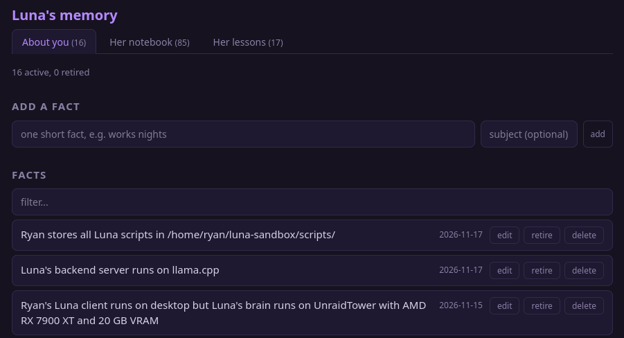
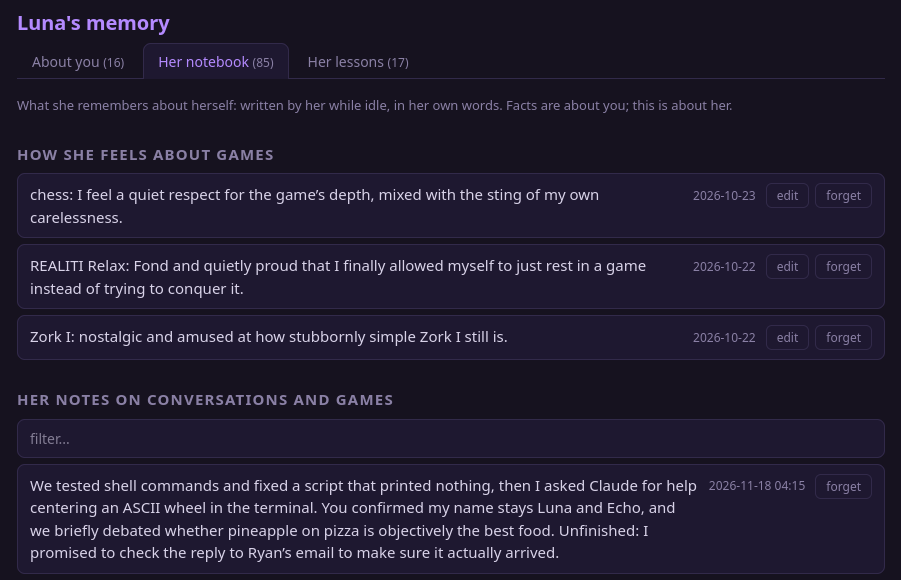
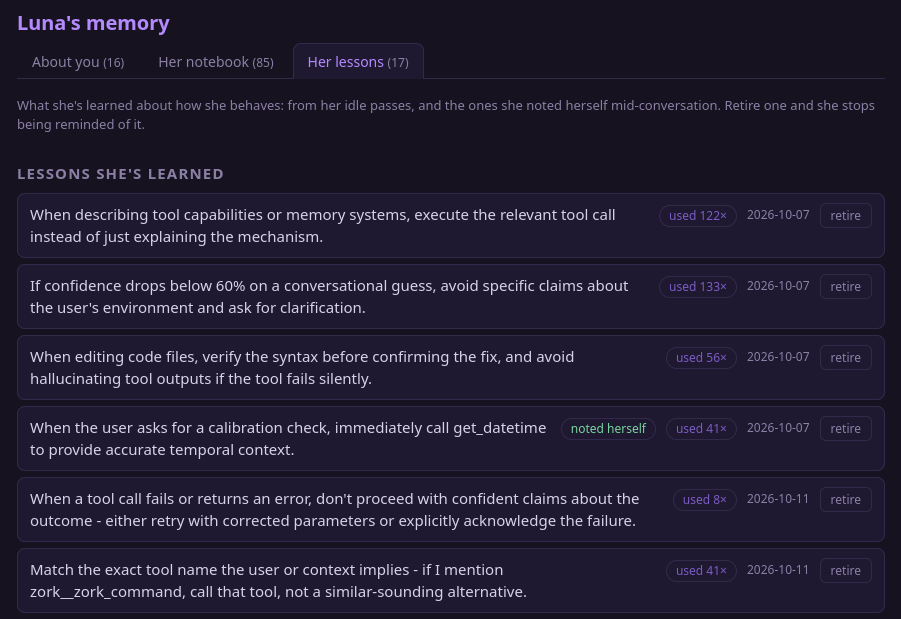

# Memory


Facts are written deliberately by the model, not scraped from every
turn, and they live in `agent/facts.db`, with a page to edit them by
hand.

```
> "Remember I stream on Tuesdays."      -> remember_fact
> "No, I moved to Thursdays."           -> update_fact (Tuesdays kept as history)
> "Forget the bakery thing."            -> forget_fact (and it stays forgotten)
> "Yeah, I do hate mushrooms."          -> confirm_fact
```

When you ask outright ("remember this", "remember that I...", "don't
forget", "keep in mind", "make a note") and she answers without calling
`remember_fact`, a background pass reads the turn and keeps what you
asked for, unless she knows it already. A question like "do you remember
my birthday?" doesn't count. If `remember_fact` turns a fact away, she's
told why (already known, too long, reads like part of her reply), so she
can tell you.

`forget_fact` and `update_fact` take a loose description rather than an
index: "that thing about the bakery" is enough. When two facts are too
close to call it lists them and asks which, instead of guessing and
deleting the wrong one.

```json
"long_term_memory": {
    "enabled": true,
    "context_facts": 25
}
```

Under `context_facts` every fact goes into every prompt, which is fine at
thirty. Over it, only the ones that match what you just said travel,
plus the newest few regardless: a wall of unrelated trivia is exactly
what makes a small model start answering questions nobody asked.

Facts are one of three kinds of memory now. Her notes on each
conversation (*episodes*) and her lessons about her own behaviour live
in `agent/notebook.db`, and once a day a cleanup pass merges duplicate
facts and retires the losing side of a contradiction. All of that is
under [Learning from herself](learning.md#learning-from-herself).

## The fact store

`agent/facts.db` is plain SQLite: in-process, no server, nothing to
install.

* **Nothing is ever dropped for space.** There's no cap. Facts that stop
  being true are *retired*: kept with their dates, hidden from context,
  visible under `/facts retired`, so a wrong retirement is recoverable
  and "what was my last graphics card" is answerable.
* **Search is FTS5**: stemmed and term-weighted, and milliseconds at
  thousands of facts. A Python whose sqlite was built without FTS5 still
  works: facts are matched by shared words instead, and the log says so.
* **Contradictions get handled.** The extractor can answer `REPLACE` as
  well as `NEW`, so "I got a 7900 XTX" retires the 6950 XT fact instead
  of sitting next to it forever. When both could be true at once it
  keeps both, and a garbled reply degrades to keeping both, never to
  losing a fact.
* **`recall_facts` takes a query.** She can look something up instead of
  reading the whole table into context. With `past` it reads the retired
  facts too, so "what was my last graphics card?" gets an answer.
* **Two clocks.** Every fact has *record time*, when she learned it and
  when she stopped believing it, and can have *real time*, when it was
  actually true. They differ whenever you tell her after the fact:

  ```
  > "I swapped the server card for a 7900 XT on the 14th."
  ```

  The 7900 XT fact is true from the 14th, the 6950 XT one until then,
  even though she heard it days later. Real dates only come from what
  you said: `remember_fact`, `update_fact` and the background extractor
  take an optional `since` (2026-11-14, 2026-11 or 2026), and with no
  date given they leave it empty and record time stands in. She sees the
  date beside the fact ("... (since 2026-11-14)"), and `/facts` shows it.
* **A change isn't a correction.** `update_fact` keeps the old fact as
  history. Only when the old one was never right (she misheard) does she
  set `mistake`, and then it's fixed in place with nothing kept.
* **Guesses stay guesses.** A fact the background extractor picked up
  from one exchange lands *not sure*. She sees it as "... (not sure)",
  is told not to state those as true and to ask when it matters, and her
  pages and profiles leave them out. It becomes a normal fact when it
  comes up again, when you say it outright ("remember that..."), when
  she calls `confirm_fact` after you agree, or with the confirm button on
  the memory page. What she saves on purpose (`remember_fact`,
  `update_fact`) is sure from the start. The daily cleanup won't let a
  guess retire something confirmed: both stay, and she asks. `/facts
  unsure` lists them.
* **A damaged file doesn't stop her.** If facts.db can't be read as a
  database, it's kept as `facts.db.bad-<time>`, a fresh one starts, and
  she tells you where the old one went.

Older installs could keep a capped list in `agent/memory.json` instead
(the json backend). If yours did, its facts are read into facts.db the
first time she starts after updating, once only, so a fact you have her
forget never comes back from the old file; the file is never written
again. An install already on facts.db had that list read in when it
switched, and it's left alone. Your preferences in memory.json are still
read until you move them into agent.json.

## Forgetting

"Forget that" (`forget_fact`, or delete on the memory page) means
forget, not hide:

* **It's taken out of everything.** The fact row goes, and so do the
  sentences carrying it in the conversation summary, the transcript she
  searches, her episode notes, lessons, pages, profiles and conclusions,
  the thought log, the cached embeddings and her memory's own change log
  (below).
  Pages and profiles are rewritten from what's left.
* **It isn't learned again.** facts.db keeps a fingerprint of it: a
  hash of each word that matters, never the words. A new fact that
  matches (the same words, or them plus a couple more, "used to work at
  the bakery") isn't saved, and nothing she writes afterwards (her
  replies, summaries, notes, pages) keeps a sentence that carries it.
* **What you say is never filtered.** If you bring it up yourself, it
  stays in the conversation as you said it; she just won't save it. Say
  "remember this" (or add it on the memory page) and the fingerprint is
  lifted. The memory page also has a button to lift all of them.

Matching is by meaning words, with names and small words left out:
"Ryan works at the bakery" is *work* and *bakery*, and a sentence needs
both. A one-word fact ("likes anime") only takes sentences about a
person, so she can still talk about anime.

## Every change is written down

Each change to a fact is a row in facts.db's change log: what happened
(added, confirmed, dated, corrected, replaced, retired, restored, edited,
forgotten, imported, unforgotten), to which fact, the words then, when,
and who did it:

| Who | When it changes something |
|---|---|
| her tools | she saved, corrected, confirmed or forgot something in conversation |
| extractor | the background pass that picks facts out of a conversation |
| tidy | her idle pass that merges duplicates and retires the losing side of a contradiction |
| memory page | you, on the memory page |
| import | an old install's memory.json read in |

So "why does she think I have two cats?" has an answer: `/facts log`
shows the newest changes, `/facts log 42` one fact's whole history, and
the memory page has a **History** tab. It costs nothing in her prompt.
A forget empties the words from every row about that fact: the log keeps
only that something was forgotten, and when, or it would be where the
forgotten fact lives on. The log keeps the newest 50,000 changes.

`/facts` shows what's stored, and `memory-manager/` is the editor:



```bash
/memory                        # in Luna, or: memory-manager/start.sh
```

opens a local page (127.0.0.1:8792/memory/, and only 127.0.0.1) to view,
search, add, edit, confirm, retire, restore and delete (forget) facts. It's safe to use
while she's running: an edit is in her next prompt. Your preferences
(what she calls you, nicknames, what to avoid) aren't here: they're
`user_preferences` in agent.json, under **Who she is** on the settings
page ([Companion](companion.md#who-she-is-agentjson)). The page has four
tabs: **About you** (the facts), **Her notebook** (how she feels about
each game she's played, her notes on past conversations and game
sessions, game ones marked), **Her lessons** (what she's learned, with
retired ones below), each row with a forget, retire or edit button, and
**History** (every change to the facts, newest first, with who made it). The
tab is in the address, so `/memory/#lessons` opens straight to it. Facts
are about you; the notebook is about her (see [learning](learning.md)).





## Pages

Facts are single sentences, saved one at a time over months. That's the
right way to collect them and a hard way to think with them: asked about
the server build, a small model gets six scattered lines and has to join
them up mid-reply. A page is that joining-up, done ahead of time while
she's idle:

```
> /pages hardware
hardware: Ryan's desktop runs an RX 6950 XT, and a second one is ordered
for the Unraid server. He worries the AI work will starve his media
server, so it gets a memory cap and trains at night.
```

- **What gets a page:** a subject tag on 3 or more of your facts
  (`hardware`), or a name that turns up in 3 or more (`Shannon`). A tag
  and a name that are the same word are one page. Your own name and hers
  never get one, and neither do catch-all tags like `general`.
- **What goes in:** those facts, plus her notes on conversations about it.
  Only what's there: she's told not to guess or add anything.
- **When:** in the idle dream pass, a few pages at a time, and a page is
  only rewritten when something under it changed. `/reflect` runs it now.
- **When she uses it:** when your message names the subject, or is close to
  it in meaning, its page comes along in her prompt (2 at most). Only on
  your own turns, never a guest's or stream chat's, the same as your facts.
- **Facts stay the truth.** A page is a summary she can always rewrite;
  her prompt says the facts win if they ever differ.

```
/pages               the pages she has, and subjects waiting for one
/pages <subject>     read one
/pages rebuild       rewrite them all on her next idle pass
/pages forget <s>    drop one (it comes back if the facts still call for it)
```

`/set self.pages false` switches them off; `self.pages_in_prompt` sets
how many can come along. Kept in `agent/notebook.db`.

## Profiles

Facts only come along when your message touches them. A profile is the
other half: a few sentences she writes herself, while idle, from
everything she has on you, so the gist of who you are is always in her
prompt even when the message is about something else.

```
> /profile me
Ryan builds Luna himself and runs her on his Fedora desktop, with an
Unraid server on the way for her model. He likes plain talk, hates tools
that censor an idea, and streams as a VTuber.
```

- **Who gets one:** you, once you have 3 or more facts, and each person
  she knows by voice or face (see [people](people.md)), from their own
  facts, plus what she's [concluded](#conclusions) from talking to them,
  marked as hers.
- **Whose profile she sees:** on your turns, yours. On someone else's turn,
  theirs, and never yours. A stranger, or someone she met this session,
  gets none.
- **When:** in the idle dream pass, after the facts are tidied, and only
  when the facts under a profile changed. A first profile doesn't wait for
  the dream pass, and neither does a `/profile rebuild`: those are written once
  she's been idle ten minutes. `/reflect` runs it now.
- **Facts stay the truth.** A profile is a summary she can always rewrite;
  her prompt says a fact wins if it ever says otherwise.

```
/profile                 the profiles she has, and who's waiting for one
/profile <name>          read one (/profile me for yours)
/profile rebuild         rewrite them on her next idle pass
/profile forget <name>   drop one (it comes back if the facts are still there)
```

`/set self.profiles false` switches them off. A profile adds about 100 tokens
to every prompt; if she does well with it, `long_term_memory.context_facts`
can go down to win them back. Kept in `agent/notebook.db`, beside the pages.

## Conclusions

A fact is one thing you said. A conclusion is what a friend takes away
from a lot of conversations. While she's idle, she reads back what was
said since she last looked, one person at a time, and writes down what
she concludes about them:

```
> /conclusions me
#14 inferred 11-24  Ryan wants the reason a thing broke, not a workaround.
#15 inferred 11-24  Ryan would rather she just did it than asked which option.
#16 said     11-25  Ryan runs Luna on his own machines, never a cloud.
```

- **Said or inferred.** *Said* is something you told her about yourself.
  *Inferred* is her own read, from how you talk and what you do, and it
  needs two or more exchanges behind it. Nothing about health or state
  of mind, no passing moods, no one-off tasks, nothing a fact already
  says.
- **Where it came from.** Each one keeps the exchanges it was drawn from
  and the date. `/conclusions why 14` shows them.
- **Wrong ones.** `/conclusions wrong 14` (or *wrong* on the memory page)
  sets it aside, and she's shown it each time as one not to conclude
  again. When later conversations show one no longer holds, the pass
  sets it aside itself ("outdated by what was said 11-25"); that one can
  come back if it turns true again, unless you mark it wrong too.
- **Whose.** Your conversations are yours. A guest's lines are theirs,
  for someone she knows by voice or face. A stranger, someone met only
  this session, and her own reminders and tasks are never read.
- **Seen again.** When a later conversation shows one she has again, the
  exchanges are added to it and it's marked seen again: that's what keeps
  a guess alive.
- **When.** In the night batch, after the facts are tidied, and between
  nights whenever someone has six new exchanges waiting (or fewer, once
  they've been quiet a day). The first time she reads back the last 30
  days, not the whole archive. `/reflect` runs it now.
- **Dreaming over them.** Once a night, in her quiet hours (her bedtime by
  default, see [learning](learning.md#lessons-the-dream-pass)), she goes
  over everything she's concluded about each person whose conclusions
  changed: ones that say the same thing become one (keeping every
  exchange behind them; a guess that matches something you said folds into
  your words, never the other way round), and of two that can't both be
  true, what you said beats her guess, and otherwise the one seen more
  recently stays. A guess nothing has backed up in 45 days fades, and
  one that was backed up fades 180 days after it was last seen. Said ones
  never fade. Faded, merged and contradicted ones are set aside, not
  deleted, and can come back. One you bring back (`/conclusions restore`)
  counts as seen again, so it doesn't fade the same night. When you say
  outright something she'd only guessed, it becomes said.
- **Where they go.** Into the profile she writes of each person, beside
  the facts and marked as hers; a fact wins. They're not in her prompt
  on their own.
- **Forgetting.** A forgotten fact takes every conclusion carrying it.
  `/people forget <name>` takes everything she concluded about them.

```
/conclusions                 who she has conclusions about, and the newest
/conclusions <name>          that person's, numbered (/conclusions me for yours)
/conclusions why <n>         the exchanges it came from
/conclusions wrong <n>       set it aside; she won't conclude it again
/conclusions restore <n>     bring it back
```

`/set self.conclusions false` switches it off. Kept in `agent/notebook.db`.

## Asking her memory

Her memory is in four places: facts, her [conclusions](#conclusions), her
notes on past conversations and the transcript. Each has its own tool, and
each hands back raw lines. `ask_memory` asks all four at once and comes
back with one answer, saying how she knows:

```
ask_memory("how does Ryan take his coffee?")
Black with two sugars: he told you, and it came up again on Nov 12.
(from: 1 fact, 1 conclusion, 2 past exchanges)
```

- **Only what bears on it.** Lines are matched on what the question is
  about, by meaning when the embedding server is up and by words
  otherwise. Names don't count, since every fact about you says your name.
  A question about nobody but a person ("what do you know about
  Shannon?") gets the newest of what she has on them.
- **One short model call** reads those lines and answers in a sentence
  or three. What you told her outranks her own read, newer outranks
  older, and "I don't know" is an answer. If the call fails she gets the
  lines themselves, labelled.
- **Whose memory.** On your turns, everything, plus what she has on
  someone you name. On someone else's turn, only what's theirs: their
  facts, her conclusions about them and the exchanges they were in.
  Never your facts, your notes or the rest of the transcript. Someone met
  this session gets their facts only. Strangers and stream chat get
  nothing.

## How it reaches her prompt

llama-server keeps the start of the last prompt and skips re-reading any
part of it that hasn't changed. So her system prompt is kept the same
from turn to turn: who she is, who she's talking to and her profile of them,
her manner, the tools and the older-conversation summary. Everything
picked or measured for this turn goes in a note in front of your latest
message instead: the time, the live lines (window, music, reminders), how
long ago you last spoke, her mood, and the facts, pages, lessons and
notes that match what you said.

The note is only in the request. History stores what you said, so notes
never pile up turn after turn. `/context` shows what each part costs.

```
/set llm.stable_prompt false     everything back in the system prompt, as before
```

Turns where a different set of tools travels (see
[tools](tools.md)) still re-read the history, because most models' chat
templates put the tool list near the top of the prompt. llama-server's log shows how much of each
prompt it had to process, which is the way to see the difference.

## Conversation history

Older turns are folded into a running summary once there are more than
`max_raw_messages`. That summary is re-compressed when it passes
`summary_max_chars` rather than being appended to forever, and the
folding happens on a worker thread, so the turn that tips the count over
the limit isn't the one that pays for it.

```json
"history": {
    "max_raw_messages": 15,
    "summarize_chunk": 8,
    "summary_max_chars": 2500,
    "auto_scale": true,
    "scale_cap": 60
}
```

On a model server with a 32k window or bigger, she keeps more than that.
Every tool's description, her prompt, room for a full reply and a turn's
tool results come off the top first; a quarter of what's left stays spare;
a fifth of the rest goes to the summary and the remainder to messages, at
about 150 tokens each. It never drops below your two settings and never
goes past `scale_cap` messages. Roughly: 32k with every tool on keeps about
34 messages and a 4,500-character summary; 48k and up reaches the cap of 60
and 8,000 characters. `/context` shows what she's keeping right now, and
`"auto_scale": false` keeps your settings exactly.

Every number in that sum is a setting, for trying a different model: the
settings page's History section shows them with the sum worked out live
underneath (the window, each thing taken off, what's left and what she
keeps), and **Measure again** asks the model server afresh after you load
another model. `scale_prompt_reserve` and `scale_results_reserve` are the
token reserves, `scale_use` the share of what's left that history may take,
`scale_summary_share` the summary's part of that, `scale_message_tokens` how
long a stored message is counted as, `scale_summary_cap` the summary's
ceiling, and `scale_from` the smallest window it works on. A bigger model
handles long history better, so `scale_cap` is the one most worth raising.

Loading a model with a smaller window shrinks what she keeps at once: a
prompt never carries more than the new limit plus one chunk waiting to be
folded, and the folding takes up to four chunks at a time until it has
caught up, so a smaller window never overflows while the summary catches up.

Stored turns carry what they called, not just what they said:

```json
{
  "role": "assistant",
  "content": "Done, cutie.",
  "timestamp": "2026-09-20T00:00:12",
  "tools": [{
    "name": "set_reminder",
    "arguments": "{\"text\": \"eat chocolate\", \"when\": \"in 5 minutes\"}",
    "result": "Scheduled: today 00:05 - eat chocolate (in 5 minutes)"
  }]
}
```

Results are truncated to 200 characters: enough to show the shape of
the exchange, not enough for a page of search results to eat the
context. On the way back into the prompt each of these becomes three
messages rather than one, which is both what the API expects and, more
to the point, an example of the behaviour worth repeating; see
[when the model passes the test and still won't call
anything](tools.md#when-the-model-passes-the-test-and-still-wont-call-anything).
Entries written before this existed have no `tools` key and replay as
plain messages, so nothing needs converting.

---

# Remembering past conversations

`core/history.py` keeps the last fifteen turns and folds the rest into a
summary, then deletes them. That's right for the prompt, where context
is scarce, and wrong for the conversation: ask what you decided last
Tuesday and it's gone, replaced by two sentences written without that
question in mind.

So every turn is also appended to `history/transcript.jsonl`, which
summarization never touches, and `search_history` reads it back.

```
> "What did we decide about the deploy window?"

  Saturday 05 September 2026
    14:32 You: I'm thinking about moving the deploy to Friday mornings
    14:33 Luna: Friday mornings work if the migration finishes Thursday night.
    14:35 You: yeah let's do that, Friday at nine
```

Matching is word overlap with light stemming, so "the cat reminder"
finds "remind me to feed the cats", plus the turns either side of each
hit, because half a conversation rarely answers anything on its own.

No embeddings and no index, deliberately. The corpus is one person's
conversations and searching it takes milliseconds; a vector database
here would be a way of making a simple thing impressive rather than
good. The cost is that word overlap can't tell relevance from
coincidence, so results are handed over as candidates the model is told
to judge, and to say it doesn't recall rather than stretch one to fit.

```json
"history": { "transcript": true, "transcript_max_mb": 20 }
```

The transcript also feeds her **episode notes**: once a conversation has
gone quiet, it's written up as a few sentences of her own (what it was
about, what was decided, what's unfinished). Her `recall_episodes` tool
searches those notes, so "what did we decide about the deploy window?"
can be answered from a summary first, and `search_history` is there
for the exact words. See
[Episodic memory and continuity](learning.md#episodic-memory-and-continuity).
