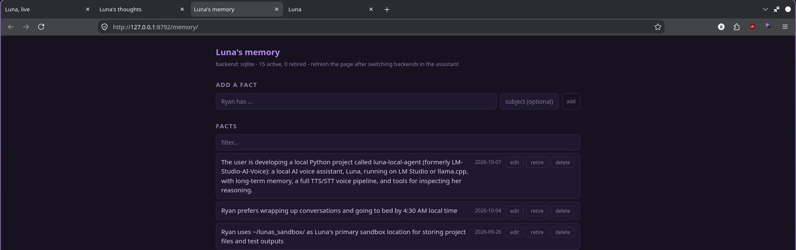

# Memory

Facts are written deliberately by the model, not scraped from every
turn, and they live in `agent/memory.json` where you can edit them by
hand. A malformed file no longer takes the app down on startup: it says
what's wrong, leaves the file alone and starts empty.

```
> "Remember I stream on Tuesdays."      -> remember_fact
> "No, I moved to Thursdays."           -> update_fact
> "Forget the bakery thing."            -> forget_fact
```

`forget_fact` and `update_fact` take a loose description rather than an
index: "that thing about the bakery" is enough. When two facts are too
close to call it lists them and asks which, instead of guessing and
deleting the wrong one.

```json
"long_term_memory": {
    "enabled": true,
    "backend": "sqlite",
    "max_facts": 30,
    "context_facts": 25
}
```

Under `context_facts` every fact goes into every prompt, which is fine at
thirty. Over it, only the ones sharing vocabulary with what you just said
travel, plus the newest few regardless: a wall of unrelated trivia is
exactly what makes a small model start answering questions nobody asked.

Facts are one of three kinds of memory now. Her notes on each
conversation (*episodes*) and her lessons about her own behaviour live
in `agent/notebook.db`, and once a day a cleanup pass merges duplicate
facts and retires the losing side of a contradiction. All of that is
under [Learning from herself](learning.md#learning-from-herself).

## The permanent store (the default)

`"backend": "sqlite"`, the default, keeps facts in a permanent table in
`agent/facts.db`: plain SQLite, in-process, no server, nothing to
install. `"backend": "json"` is the original capped list in
`memory.json`. What the table does that the list doesn't:

* **Nothing is ever dropped for space.** The JSON backend deletes the
  oldest fact once it passes `max_facts`; the table has no cap. Facts
  that stop being true are *retired*: kept with their dates, hidden
  from context, visible under `/facts retired`, so a wrong retirement
  is recoverable and "what was my last graphics card" is answerable.
* **Search is FTS5**: stemmed and term-weighted instead of raw word
  overlap, and milliseconds at thousands of facts.
* **Contradictions get handled.** The extractor can answer `REPLACE` as
  well as `NEW`, so "I got a 7900 XTX" retires the 6950 XT fact instead
  of sitting next to it forever. When both could be true at once it
  keeps both, and a garbled reply degrades to keeping both, never to
  losing a fact.
* **`recall_facts` takes a query.** She can look something up instead of
  reading the whole table into context.

`/facts` shows what's stored and which backend is live, and
`memory-manager/` is the editor:



```bash
/memory                        # in Luna, or: memory-manager/start.sh
```

opens a local page (127.0.0.1:8792/memory/, and only 127.0.0.1) to view,
search, add, edit, retire, restore and delete facts, plus edit the
`user_preferences` block of `memory.json`, whichever backend is
active. Below the facts is **her notebook**: how she feels about each
game she's played, her notes on past conversations and game sessions
(game ones marked), and the lessons she's learned, each with a forget,
retire or edit button. Facts are about you; the notebook is about her
(see [learning](learning.md)). On sqlite it's safe to use while she's running; on json the
page warns you that a running assistant can overwrite your edits when
it next saves. The switch is
live in both directions and loses nothing:

```
/set long_term_memory.backend sqlite    json facts are absorbed into the table
/set long_term_memory.backend json      newest max_facts are written back to
                                        memory.json; the rest wait in the db
```

The db is always the superset and the JSON file is always the limited
view, which is what makes the setting safe to flip the day it misbehaves.
If this python's sqlite lacks FTS5 the setting quietly stays on json and
the log says why.

## Pages

Facts are single sentences, saved one at a time over months. That's the
right way to collect them and a hard way to think with them: asked about
the server build, a small model gets six scattered lines and has to join
them up mid-reply. A page is that joining-up, done ahead of time while
she's idle:

```
> /pages hardware
hardware: Ryan's desktop runs an RX 6950 XT, and a second one is ordered
for the Unraid server. He worries the AI work will starve his media
server, so it gets a memory cap and trains at night.
```

- **What gets a page:** a subject tag on 3 or more of your facts
  (`hardware`), or a name that turns up in 3 or more (`Shannon`). A tag
  and a name that are the same word are one page. Your own name and hers
  never get one, and neither do catch-all tags like `general`.
- **What goes in:** those facts, plus her notes on conversations about it.
  Only what's there: she's told not to guess or add anything.
- **When:** in the idle dream pass, a few pages at a time, and a page is
  only rewritten when something under it changed. `/reflect` runs it now.
- **When she uses it:** when your message names the subject, or is close to
  it in meaning, its page comes along in her prompt (2 at most). Only on
  your own turns, never a guest's or stream chat's, the same as your facts.
- **Facts stay the truth.** A page is a summary she can always rewrite;
  her prompt says the facts win if they ever differ.

```
/pages               the pages she has, and subjects waiting for one
/pages <subject>     read one
/pages rebuild       rewrite them all on her next idle pass
/pages forget <s>    drop one (it comes back if the facts still call for it)
```

`/set self.pages false` switches them off; `self.pages_in_prompt` sets
how many can come along. Kept in `agent/notebook.db`.

## Profiles

Facts only come along when your message touches them. A profile is the
other half: a few sentences she writes herself, while idle, from
everything she has on you, so the gist of who you are is always in her
prompt even when the message is about something else.

```
> /profile me
Ryan builds Luna himself and runs her on his Fedora desktop, with an
Unraid server on the way for her model. He likes plain talk, hates tools
that censor an idea, and streams as a VTuber.
```

- **Who gets one:** you, once you have 3 or more facts, and each person
  she knows by voice or face (see [people](people.md)), from their own
  facts.
- **Whose profile she sees:** on your turns, yours. On someone else's turn,
  theirs, and never yours. A stranger, or someone she met this session,
  gets none.
- **When:** in the idle dream pass, after the facts are tidied, and only
  when the facts under a profile changed. A first profile doesn't wait for
  the dream pass, and neither does a `/profile rebuild`: those are written once
  she's been idle ten minutes. `/reflect` runs it now.
- **Facts stay the truth.** A profile is a summary she can always rewrite;
  her prompt says a fact wins if it ever says otherwise.

```
/profile                 the profiles she has, and who's waiting for one
/profile <name>          read one (/profile me for yours)
/profile rebuild         rewrite them on her next idle pass
/profile forget <name>   drop one (it comes back if the facts are still there)
```

`/set self.profiles false` switches them off. A profile adds about 100 tokens
to every prompt; if she does well with it, `long_term_memory.context_facts`
can go down to win them back. Kept in `agent/notebook.db`, beside the pages.

## How it reaches her prompt

llama-server keeps the start of the last prompt and skips re-reading any
part of it that hasn't changed. So her system prompt is kept the same
from turn to turn: who she is, who she's talking to and her profile of them,
her manner, the tools and the older-conversation summary. Everything
picked or measured for this turn goes in a note in front of your latest
message instead: the time, the live lines (window, music, reminders), how
long ago you last spoke, her mood, and the facts, pages, lessons and
notes that match what you said.

The note is only in the request. History stores what you said, so notes
never pile up turn after turn. `/context` shows what each part costs.

```
/set llm.stable_prompt false     everything back in the system prompt, as before
```

Turns where a different set of tools travels (see
[tools](tools.md)) still re-read the history, because most models' chat
templates put the tool list near the top of the prompt. llama-server's log shows how much of each
prompt it had to process, which is the way to see the difference.

## Conversation history

Older turns are folded into a running summary once there are more than
`max_raw_messages`. That summary is re-compressed when it passes
`summary_max_chars` rather than being appended to forever, and the
folding happens on a worker thread, so the turn that tips the count over
the limit isn't the one that pays for it.

```json
"history": {
    "max_raw_messages": 15,
    "summarize_chunk": 8,
    "summary_max_chars": 2500
}
```

Stored turns carry what they called, not just what they said:

```json
{
  "role": "assistant",
  "content": "Done, cutie.",
  "timestamp": "2026-09-20T00:00:12",
  "tools": [{
    "name": "set_reminder",
    "arguments": "{\"text\": \"eat chocolate\", \"when\": \"in 5 minutes\"}",
    "result": "Scheduled: today 00:05 - eat chocolate (in 5 minutes)"
  }]
}
```

Results are truncated to 200 characters: enough to show the shape of
the exchange, not enough for a page of search results to eat the
context. On the way back into the prompt each of these becomes three
messages rather than one, which is both what the API expects and, more
to the point, an example of the behaviour worth repeating; see
[when the model passes the test and still won't call
anything](tools.md#when-the-model-passes-the-test-and-still-wont-call-anything).
Entries written before this existed have no `tools` key and replay as
plain messages, so nothing needs converting.

---

# Remembering past conversations

`core/history.py` keeps the last fifteen turns and folds the rest into a
summary, then deletes them. That's right for the prompt, where context
is scarce, and wrong for the conversation: ask what you decided last
Tuesday and it's gone, replaced by two sentences written without that
question in mind.

So every turn is also appended to `history/transcript.jsonl`, which
summarization never touches, and `search_history` reads it back.

```
> "What did we decide about the deploy window?"

  Saturday 05 September 2026
    14:32 You: I'm thinking about moving the deploy to Friday mornings
    14:33 Luna: Friday mornings work if the migration finishes Thursday night.
    14:35 You: yeah let's do that, Friday at nine
```

Matching is word overlap with light stemming, so "the cat reminder"
finds "remind me to feed the cats", plus the turns either side of each
hit, because half a conversation rarely answers anything on its own.

No embeddings and no index, deliberately. The corpus is one person's
conversations and searching it takes milliseconds; a vector database
here would be a way of making a simple thing impressive rather than
good. The cost is that word overlap can't tell relevance from
coincidence, so results are handed over as candidates the model is told
to judge, and to say it doesn't recall rather than stretch one to fit.

```json
"history": { "transcript": true, "transcript_max_mb": 20 }
```

The transcript also feeds her **episode notes**: once a conversation has
gone quiet, it's written up as a few sentences of her own (what it was
about, what was decided, what's unfinished). Her `recall_episodes` tool
searches those notes, so "what did we decide about the deploy window?"
can be answered from a summary first, and `search_history` is there
for the exact words. See
[Episodic memory and continuity](learning.md#episodic-memory-and-continuity).
