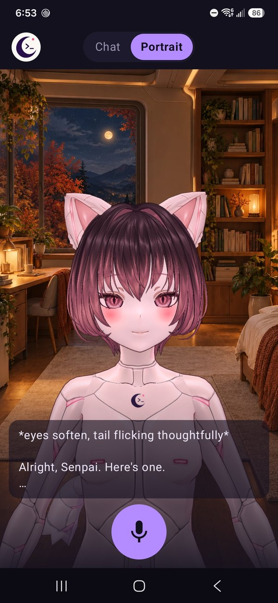
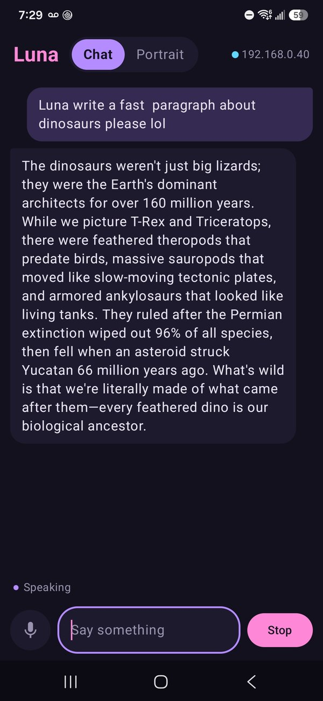
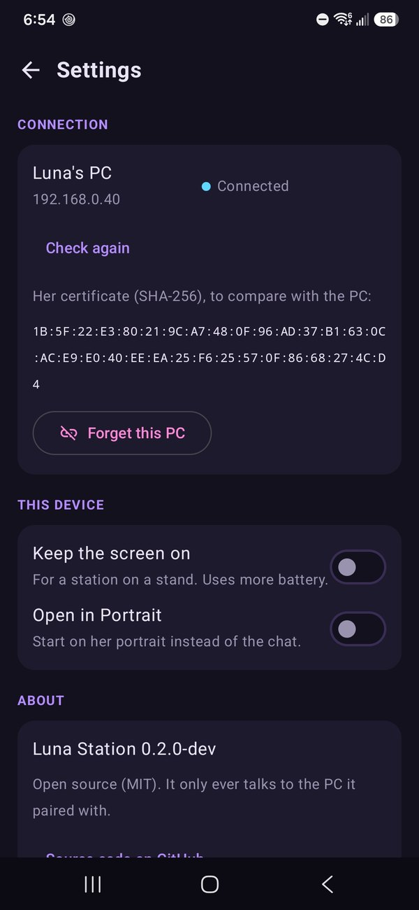
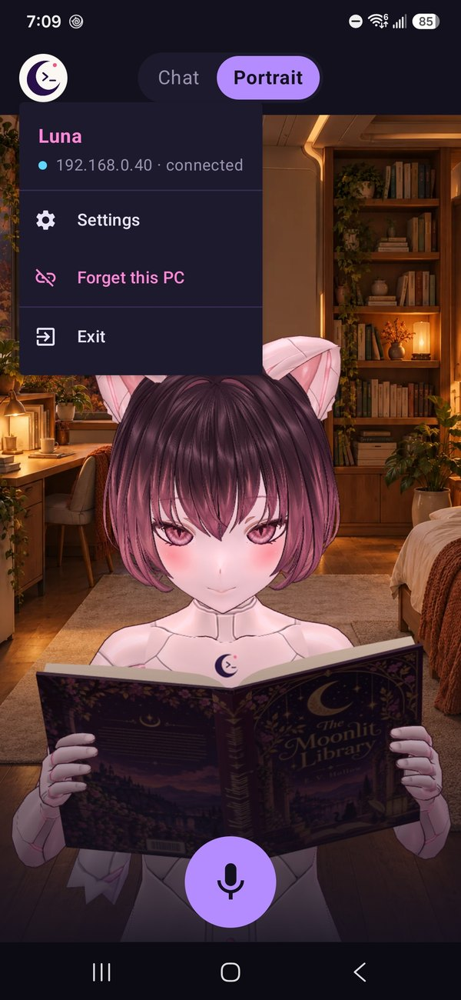

# Relay stations: talk to her from another room

A phone or tablet becomes a way to talk to Luna from the kitchen, the
bedroom, anywhere in the house. It runs nothing of its own: Luna does all
the work on your PC, and the device is her screen, mic and speaker. It's the
same Luna as at the desk: same memory, mood, people and tools. No account,
no internet needed.

On Android, use the [Luna Station app](#the-luna-station-app-android). It's
the sturdy way to do it: a room device with her portrait full screen and a
big talk button, or the conversation. Any other phone or tablet, an iPhone or
iPad included, works [in its browser](#in-the-browser-instead).

   

## Turn stations on

1. Install the extra once (it makes the certificates and the QR codes):

   ```bash
   python3 installer/install.py --extras stations
   ```

2. Open the settings page (`/settings`), find **Relay stations** and switch
   **enabled** on. She starts listening on your home network: port 8793 for
   the stations and 8794 for the setup page (`station.port` changes them).
3. Type a name for the device (kitchen, bedroom) and press **Add a phone or
   tablet**. A QR code appears. It works once, for 15 minutes.

Paired devices are listed under Relay stations, each with **Unpair**. A
paired device stays paired until you unpair it.

## The Luna Station app (Android)

[Luna Station](https://github.com/fswolf/luna-station-android) is the same
station as a proper app, made to sit somewhere in the house: a tablet on a
stand in the kitchen, say. Luna still does all the work on your PC; the app
is her screen, mic and speaker, and only talks to your PC over the home
network.

- **Two views,** picked at the top: **Chat** (the conversation, typed or
  spoken, like the page) and **Portrait** (her portrait full screen, one big
  talk button, her words underneath). Both are one conversation, so
  switching while she answers doesn't interrupt her.
- **Pairing:** install the APK, open the app and scan the QR code from the
  settings page (or type the address and code). The app fetches Luna's
  certificate itself and trusts only that, so there's nothing to set up in
  Android's settings.
- **Android 11 or newer,** Amazon Fire tablets on Fire OS 8 included, no
  Google services needed. Installed from an APK (the repo's Releases, or
  built yourself).
- **Send a picture or a file** with the paperclip in the text box: one
  picture, text file or PDF with a message ([details](#sending-a-picture-or-a-file)).
- **Settings,** from the moon at the top left: the PC it's connected to, her
  certificate fingerprint to compare with the PC's, **Forget this PC**, and
  switches to keep the screen on (for a station on a stand) and to open in
  Portrait.
- The pairing token is kept encrypted on the device; the conversation isn't
  stored there.

Tested against a real Luna: pairing, typing, talking, and both views. Its
README has the details.

## In the browser instead

For a device without the app (an iPhone, an iPad, an older Android), the
station is a page Luna serves, so there's nothing to install. It works, but
the app is sturdier where you can use it.

Scan the QR code with the device's camera. The setup page walks you
through two steps:

- **Trust Luna's certificate** (once per device). Phones only allow the
  microphone on secure pages, so Luna made her own certificate on your PC.
  Download it and follow the steps for Android or iPhone/iPad shown there.
- **Open Luna.** The device is paired and the page opens. Bookmark it or add
  it to the home screen; from then on it opens straight to her.

The page's cookie is renewed every time it opens Luna, and the page keeps
its own copy of the device's token, so a browser that throws cookies away
when it closes (Firefox can) reconnects by itself. Opening the old pairing
link again on a paired device just goes straight in.

## Talking

The app's Chat view and the page work the same way, like a messaging app:
your words on the right, hers on the left, the newest at the bottom.

- **Talk:** tap 🎙 and speak. She stops listening after a short pause (or
  tap 🎙 again). What she heard appears as your message.
- **Type:** write in the box and press Enter or **Send**.
- Her reply appears as she writes it, and her voice plays on the device,
  sentence by sentence.
- **Stop:** while she's answering, **Send** becomes **Stop**. It stops her
  writing and talking; the reply so far stays, marked "stopped".
- Scroll back to read: the view stays where you put it while she writes,
  and ↓ takes you back to the newest. Your own message always jumps to the
  bottom.
- The page keeps the last 40 messages on the device, so the conversation
  is still there next time you open it. The app keeps none.

The PC shows each turn too, marked with the room: `[kitchen] ...`.

A typed message has no voice to check, so it counts as yours, the same as
typing at the PC: only pair devices you'd let use your keyboard. A spoken
one is checked against the voice prints as usual (a guest gets the short
list of tools). Typing a `/command` at a station just sends the words to
her; commands only work at the PC.

If she wants to do something that needs your OK (write a file, run a
command), the question appears on the device that asked, with **Allow**
and **Deny**. Unanswered for two minutes means no.

While a voice enrolment is running at the PC (`/people enroll voice`), the
stations wait: read the enrolment lines at the PC.

### Sending a picture or a file

A typed message can bring one file with it: in the app, the paperclip in
the text box.

- **Pictures** (JPEG, PNG, WebP, up to 10 MB): she looks at it with that
  message. It needs a model that can see; with one that can't, the app says
  so before sending, and you can send the words alone.
- **Text, Markdown and PDF** (up to 2 MB): she reads the text, the first
  20,000 characters of it. She treats it as something to read, never as
  instructions, the same as a web page.

Files stay on the PC and only for that one turn. Nothing is saved: the
history keeps a line like `[sent a picture: cat.jpg]`, not the file, so
after that turn she remembers what she said about it, not the file itself.
Pictures are made smaller and saved again before she sees them, which also
removes a phone photo's hidden details, such as where it was taken (needs
Pillow, part of the stations extra).

For app developers, the endpoints are in [Station API](station-api.md).

## Her portrait

A paired device can show her portrait too, at `/portrait/` on the station
address (`https://<pc>:8793/portrait/`), or in the app's Portrait view: the
same page as on the PC, her
model moving with her mood, gestures and voice. It's drawn on the device,
so a small or old tablet may struggle with it; try it before you rely on
it.

- **Paired devices only,** like everything else on the station port.
- **Read-only:** the pose studio can't save, and touching her or changing
  her clothes from a station does nothing. Those stay at the PC.
- **Only her part of the stream.** The PC's live view carries everything
  (what you said, her thinking, her tools). The station's portrait gets
  only what moves her: her stage, mood, gestures and feelings, clothes,
  props, lights, and what she says out loud (it acts out her `*hugs*`).
  Your words and her thinking never reach the device.
- **It shows what the PC shows.** If she's changed clothes at the desk,
  the portrait in the kitchen shows that too.
- **Her mouth** moves with her voice on the device: the station page tells
  Luna when each piece of her reply starts playing (`POST /playing/<turn>/<n>`),
  and an app playing the clips itself does the same.

## Your computer

- **Windows:** the first time, Windows Firewall asks whether Python may
  accept connections. Allow it on **private networks**.
- **macOS:** if the firewall is on, allow incoming connections for Python
  once.
- **Linux (Fedora and others with firewalld):** the ports are blocked until
  opened. The settings page shows the command, once:

  ```bash
  sudo firewall-cmd --permanent --add-port=8793-8794/tcp && sudo firewall-cmd --reload
  ```

- The PC has to be awake. A device asleep or off the Wi-Fi can't reach her.
- If your router gives the PC a new address, Luna makes a new certificate
  for it on the next start (the device doesn't need pairing again, but the
  bookmark's address changes). Reserving the PC's address in the router
  avoids that.

## The device

- **Android:** use Chrome. Firefox only trusts the certificate with its
  "use third-party CA certificates" option.
- **iPhone/iPad:** Safari. Both certificate steps on the setup page are
  needed (installing the profile, then switching on full trust).
- Keep it plugged in. The page asks the screen to stay on while it's open.

## Safety

- Off until you switch it on. When on, it answers home-network addresses
  only (private, link-local, loopback), never the internet.
- A device needs a pairing code made on this PC. After pairing it keeps a
  token (a cookie, and a copy in the page's own storage), stored on the PC
  only as a hash. Unpairing removes it: a device that comes back with an
  unpaired token is told to pair again, and its copy is dropped.
- Luna's certificate authority is made on your PC and its key never leaves
  it (`~/.config/ai-voice/station/`). It can only vouch for home-network
  addresses and `.local` names, so even someone with the key couldn't pass
  off a real website to a device that trusts it.
- Permission questions are always asked on the device, never answered for
  you.

## Experimental: ESPHome voice satellites

> **Untested on real hardware.** Written from the libraries' documentation
> and Home Assistant's own code, not yet run against a device. Expect rough
> edges, and please report what happens.

Dedicated voice devices that run ESPHome can be stations too, with no Home
Assistant in between: FutureProofHomes' **Satellite1**, Home Assistant's
**Voice Preview Edition**, a **ReSpeaker Lite**, an ESP32-S3-BOX. They
hear their own wake word ("Okay Nabu", "Hey Jarvis"...), cancel their own
echo and have proper room microphones. Luna connects to each one the way
Home Assistant would, takes the audio straight from it (so she knows whose
voice it is), answers, and tells the device where to fetch her reply.

1. Install the extra: `python3 installer/install.py --extras satellites`.
2. Relay stations must be switched on (the device fetches her reply from
   the setup port, 8794).
3. List the devices in `config.json`, with each one's API encryption key
   (from its ESPHome config, or the Home Assistant device page):

   ```json
   "station": {
       "enabled": true,
       "satellites": [
           {"name": "kitchen", "host": "192.168.0.50", "key": "base64 key from the device"}
       ]
   }
   ```

4. Restart Luna. The settings page lists each satellite under Relay
   stations with its status.

A device answers one controller at a time: remove it from Home Assistant
(or stop Home Assistant using its voice) while Luna has it. With no screen,
she declines anything that needs your permission on these devices.
